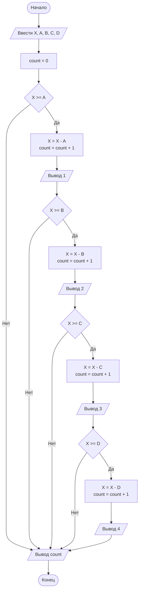

## Отчет по лабораторной работе № 1

#### № группы: `ПМ-2601`

#### Выполнила: `Новикова Полина Андреевна`

#### Вариант: `16`

### Cодержание:

- [Постановка задачи](#1-постановка-задачи)
- [Входные и выходные данные](#2-входные-и-выходные-данные)
- [Выбор структуры данных](#3-выбор-структуры-данных)
- [Алгоритм](#4-алгоритм)
- [Программа](#5-программа)
- [Анализ правильности решения](#6-анализ-правильности-решения)

### 1. Постановка задачи
> Поставим ограничение на максимально возможный объем ванночек. Пусть не превышает 30 000 литров. Литры будем считать в целых числах.
> Программа получает на вход 5 натуральных чисел `X`, `A`, `B`, `C`, `D`. В верхнюю ванночку объёмом `A` литров
>выливают `X` литров воды. Если количество воды в ванночке превышает её объём, излишки переливаются в следующую ванночку, расположенную ниже. Нужно определить количество ванночек, которые окажутся полностью заполненными, и номера этих ванночек.

Данную задачу можно разделить на 2 подзадачи: определение количества полностью заполненных ванночек и определение номеров этих ванночек.

- Для 1 подзадачи нужно последовательно рассмотреть 4 ванночки:

  1. Если `X >= A`, первая ванночка полностью заполнена, а в следующую переливается `X - A` литров.
  2. Если оставшаяся вода `X >= B`, вторая ванночка полностью заполнена, а в следующую переливается `X - B`.
  3. Если оставшаяся вода `X >= C`, третья ванночка полностью заполнена, а в следующую переливается `X - C`.
  4. Если оставшаяся вода `X >= D`, четвёртая ванночка полностью заполнена.

- Для 2 подзадачи при выполнении каждого из условий `X >= A`, `X >= B`, `X >= C`, `X >= D` необходимо запомнить номер соответствующей полностью заполненной ванночки.

Таким образом, необходимо последовательно сравнивать количество оставшейся воды с объёмом каждой ванночки и при полном заполнении переливать излишек в следующую.

### 2. Входные и выходные данные

#### Данные на вход

На вход программа должна получать 5 натуральных чисел `X`, `A`, `B`, `C`, `D`.  
По условию все числа являются натуральными, поэтому минимальное значение каждого из них равно 1. Верхние границы в условии не указаны.

|                        | Тип                 | min значение | max значение |
|------------------------|---------------------|--------------|--------------|
| X (Объём воды)         | Натуральное число   | 1            | не указано   |
| A (Объём 1-й ванночки) | Натуральное число   | 1            | не указано   |
| B (Объём 2-й ванночки) | Натуральное число   | 1            | не указано   |
| C (Объём 3-й ванночки) | Натуральное число   | 1            | не указано   |
| D (Объём 4-й ванночки) | Натуральное число   | 1            | не указано   |

#### Данные на выход

Программа должна определить количество ванночек, которые окажутся полностью заполненными, а также номера этих ванночек.

На выход программа должна вывести количество полностью заполненных ванночек и номера заполненных ванночек.

|                      | Тип                            | min значение | max значение |
|----------------------|--------------------------------|--------------|--------------|
| Количество ванночек  | Целое неотрицательное число    | 0            | 4            |
| Номера ванночек      | Целые числа                    | 1            | 4            |

Если ни одна ванночка не заполнена полностью, количество заполненных ванночек равно `0`.

### 3. Выбор структуры данных

Программа получает 5 натуральных чисел: `X`, `A`, `B`, `C`, `D`. Для их хранения можно выделить 5 переменных типа `int`. Также для хранения количества полностью заполненных ванночек используется переменная `count` типа `int`.

|                       | название переменной | Тип (в Java) |
|-----------------------|---------------------|--------------|
| X (Объём воды)        | `X`                 | `int`        |
| A (Объём 1-й ванночки) | `A`                | `int`        |
| B (Объём 2-й ванночки) | `B`                | `int`        |
| C (Объём 3-й ванночки) | `C`                | `int`        |
| D (Объём 4-й ванночки) | `D`                | `int`        |
| Количество ванночек   | `count`             | `int`        |

Дополнительные структуры данных для решения задачи не требуются. Для вывода номеров заполненных ванночек отдельные переменные не используются.

### 4. Алгоритм

#### Алгоритм выполнения программы:

1. **Ввод данных:**  
   Программа считывает пять натуральных чисел `X`, `A`, `B`, `C` и `D`, где `X` — объём воды, а `A`, `B`, `C`, `D` — объёмы четырёх ванночек. Также устанавливается счётчик `count = 0`.

2. **Проверка первой ванночки:**  
   Программа сравнивает `X` и `A`.
   - Если `X >= A`, первая ванночка полностью заполняется. Из `X` вычитается `A`, счётчик увеличивается на 1, выводится номер ванночки `1`, а оставшаяся вода передаётся во вторую ванночку.
   - Если `X < A`, первая ванночка не заполняется полностью.

3. **Проверка второй ванночки:**  
   Если первая ванночка была полностью заполнена, оставшееся количество воды сравнивается с `B`.
   - Если `X >= B`, вторая ванночка полностью заполняется. Из `X` вычитается `B`, счётчик увеличивается на 1, выводится номер ванночки `2`, а оставшаяся вода передаётся в третью ванночку.
   - Если `X < B`, вторая ванночка не заполняется полностью.

4. **Проверка третьей ванночки:**  
   Если вторая ванночка была полностью заполнена, оставшееся количество воды сравнивается с `C`.
   - Если `X >= C`, третья ванночка полностью заполняется. Из `X` вычитается `C`, счётчик увеличивается на 1, выводится номер ванночки `3`, а оставшаяся вода передаётся в четвёртую ванночку.
   - Если `X < C`, третья ванночка не заполняется полностью.

5. **Проверка четвёртой ванночки:**  
   Если третья ванночка была полностью заполнена, оставшееся количество воды сравнивается с `D`.
   - Если `X >= D`, четвёртая ванночка полностью заполняется. Счётчик увеличивается на 1 и выводится номер ванночки `4`.
   - Если `X < D`, четвёртая ванночка не заполняется полностью.

6. **Вывод количества:**  
   После выполнения всех проверок программа выводит количество полностью заполненных ванночек, хранящееся в переменной `count`.

#### Блок-схема



### 5. Программа

```java
import java.io.PrintStream;
import java.util.Scanner;

public class Main {
    public static Scanner in = new Scanner(System.in);
    public static PrintStream out = System.out;

    public static void main(String[] args) {
        int X = in.nextInt();
        int A = in.nextInt();
        int B = in.nextInt();
        int C = in.nextInt();
        int D = in.nextInt();

        int count = 0;

        if (X >= A) {
            X = X - A;
            count++;
            out.print("1 ");

            if (X >= B) {
                X = X - B;
                count++;
                out.print("2 ");

                if (X >= C) {
                    X = X - C;
                    count++;
                    out.print("3 ");

                    if (X >= D) {
                        count++;
                        out.print("4 ");
                    }
                }
            }
        }

        out.println();
        out.println(count);
    }
}

```

### 6. Анализ правильности решения

Программа работает корректно на всем множестве решений с учетом ограничений.

1. Тест на заполнение всех четырёх ванночек:

    - **Input**:
        ```
        15 2 3 4 6
        ```

    - **Output**:
        ```
        1 2 3 4 
        4
        ```

2. Тест на заполнение первых трёх ванночек:

    - **Input**:
        ```
        10 2 3 4 6
        ```

    - **Output**:
        ```
        1 2 3 
        3
        ```

3. Тест на заполнение первых двух ванночек:

    - **Input**:
        ```
        7 2 3 4 6
        ```

    - **Output**:
        ```
        1 2 
        2
        ```

4. Тест на заполнение только первой ванночки:

    - **Input**:
        ```
        3 2 5 4 6
        ```

    - **Output**:
        ```
        1 
        1
        ```

5. Тест на незаполненную первую ванночку:

    - **Input**:
        ```
        1 2 3 4 5
        ```

    - **Output**:
        ```
        0
        ```

6. Тест на точное заполнение всех ванночек:

    - **Input**:
        ```
        10 1 2 3 4
        ```

    - **Output**:
        ```
        1 2 3 4 
        4
        ```
